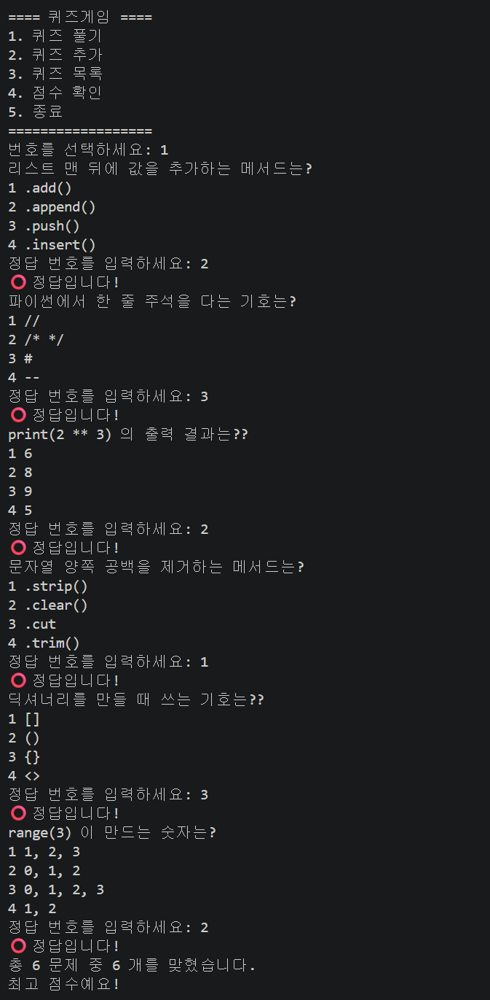
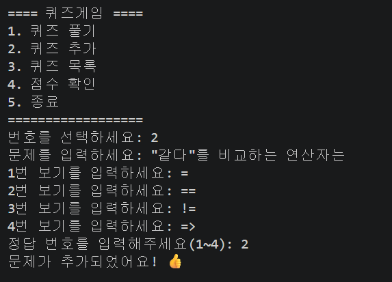
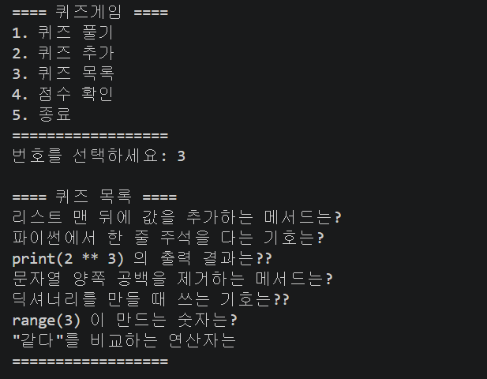
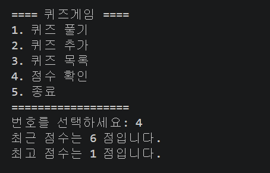
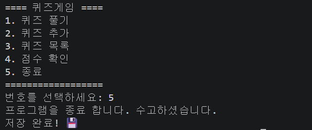

# 🎯 파이썬 퀴즈 게임

## 📖 프로젝트 개요

파이썬으로 만든 콘솔 기반 퀴즈 게임입니다.
사용자는 퀴즈를 풀고, 직접 문제를 추가하며, 점수를 기록할 수 있습니다.
프로그램을 종료하면 퀴즈와 점수가 파일에 자동 저장되어,
다시 실행할 때 이어서 사용할 수 있습니다.

## 💡 퀴즈 주제와 선정 이유

**주제: 파이썬 기초 문법**

파이썬을 처음 배우면서 가장 헷갈렸던 개념들을 퀴즈로 만들었습니다.
리스트 메서드, 주석 기호, 연산자, 문자열 메서드, 자료형 등
직접 공부하며 어려웠던 내용을 문제로 정리하면,
저도 복습이 되고 다른 사람도 함께 배울 수 있다고 생각해 선정했습니다.

## 🚀 실행 방법

    python3 Quiz.py

실행하면 아래 메뉴가 나타납니다.

## ✨ 기능 목록

- **퀴즈 풀기**: 등록된 문제를 순서대로 풀고 정답을 확인합니다.

- **퀴즈 추가**: 문제, 보기 4개, 정답을 직접 추가할 수 있습니다.

- **퀴즈 목록**: 현재 등록된 문제 목록을 확인합니다.

- **점수 확인**: 최근 점수와 최고 점수를 확인합니다.

- **자동 저장/불러오기**: 종료 시 저장, 실행 시 불러오기 됩니다.

## 📂 파일 구조

    E1-2/
    ├── Quiz.py        # 메인 프로그램
    ├── state.json     # 퀴즈·점수 저장 파일 (실행 시 자동 생성)
    └── README.md      # 설명 문서

## 💾 데이터 파일 설명 (state.json)

- **경로**: 프로그램과 같은 폴더 (Quiz.py와 동일 위치)
- **역할**: 퀴즈 목록과 최고 점수를 저장하고 불러옵니다.
  프로그램 종료 시 저장되고, 실행 시 불러옵니다.
  파일이 없으면 기본 퀴즈로 시작합니다.
- **형식**: JSON (UTF-8 인코딩으로 한글 유지)

### 📋 데이터 파일 설명

-state.json 예시
    {
      "quizzes": [
        {
          "question": "리스트 맨 뒤에 값을 추가하는 메서드는?",
          "choices": [".add()", ".append()", ".push()", ".insert()"],
          "answer": 2
        }
      ],
      "best_score": 5
    }

| 키 | 타입 | 설명 |
|------|------|------|
| quizzes | 리스트 | 퀴즈 문제들의 목록 |
| question | 문자열 | 문제 내용 |
| choices | 리스트 | 보기 4개 |
| answer | 정수 | 정답 번호 (1~4) |
| best_score | 정수 | 역대 최고 점수 |
