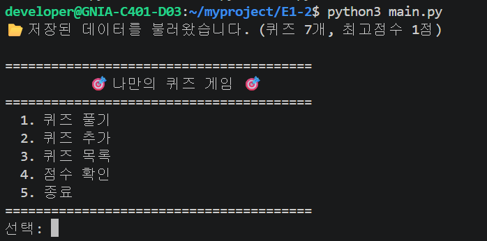
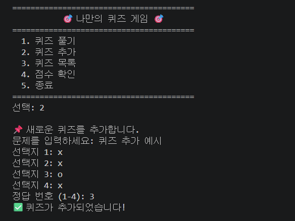
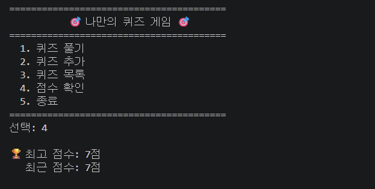

# 🎯 나만의 퀴즈 게임 (E1-2)

터미널에서 동작하는 콘솔 기반 퀴즈 게임입니다. Python 기본 문법과 객체 지향(클래스), JSON 파일 저장으로 데이터 영속성을 구현하고, Git으로 변경 이력을 관리한 미션 과제입니다.

---

## 📖 프로젝트 개요

파이썬으로 만든 콘솔 기반 퀴즈 게임입니다. 사용자는 퀴즈를 풀고, 직접 문제를 추가하며, 점수를 기록할 수 있습니다. 프로그램을 종료해도 추가한 퀴즈와 최고 점수가 `state.json` 파일에 저장되어, 다시 실행할 때 이어서 사용할 수 있습니다.

주요 메뉴는 다음 5가지입니다.

1. 퀴즈 풀기
2. 퀴즈 추가
3. 퀴즈 목록
4. 점수 확인
5. 종료

---

## 💡 퀴즈 주제와 선정 이유

**주제: 파이썬 기초 문법**

파이썬을 처음 배우면서 가장 헷갈렸던 개념들을 퀴즈로 만들었습니다. 리스트 메서드, 주석 기호, 연산자, 문자열 메서드, 자료형 등 직접 공부하며 어려웠던 내용을 문제로 정리하면, 저도 복습이 되고 다른 사람도 함께 배울 수 있다고 생각해 선정했습니다. 기본 퀴즈로 7문제(5문제 이상)를 직접 작성해 포함했습니다.

---

## 🚀 실행 방법

Python 3.10 이상이 필요합니다. 외부 라이브러리 없이 표준 라이브러리만 사용합니다.

```bash
python main.py
```

> 환경에 따라 `python3 main.py` 로 실행합니다.

실행하면 아래 메뉴가 나타납니다.



---

## ✨ 기능 목록

| 번호 | 기능 | 설명 |
|------|------|------|
| 1 | 퀴즈 풀기 | 등록된 문제를 순서대로 출제하고 정답/오답을 확인한 뒤, 총 점수를 표시합니다. |
| 2 | 퀴즈 추가 | 문제, 보기 4개, 정답 번호를 입력받아 새 퀴즈를 등록합니다. |
| 3 | 퀴즈 목록 | 현재 등록된 퀴즈 목록을 확인합니다. |
| 4 | 점수 확인 | 최고 점수와 최근 점수를 확인합니다. |
| 5 | 종료 | 데이터를 저장하고 프로그램을 종료합니다. |

**퀴즈 풀기**


**퀴즈 추가**



**퀴즈 목록**


**점수 확인**



**자동 저장 / 불러오기** — 종료 시 저장되고, 실행 시 불러옵니다.


### 메뉴·입력 안내 (유효성 규칙)

숫자를 입력받는 모든 곳에서 아래 잘못된 입력을 처리하고, 안내 메시지를 출력한 뒤 다시 입력받습니다.

- **빈 입력**(그냥 Enter) → `⚠️ 빈 입력입니다...`
- **숫자가 아닌 값**(`abc` 등) → `⚠️ 숫자가 아닙니다...`
- **허용 범위 밖**(메뉴에서 9, 정답에서 0 등) → `⚠️ 범위를 벗어났습니다...`
- 입력 앞뒤 **공백은 자동 제거** 후 처리합니다.
- 실행 중 **`Ctrl+C`(KeyboardInterrupt)** 나 **입력 종료(EOF)** 가 발생해도 비정상 종료하지 않고, 안내 후 **저장하고 안전하게 종료**합니다.

---

## 🧩 코드 구조 (클래스 설계)

모든 로직을 한 함수에 몰아넣지 않고, 역할에 따라 **2개의 클래스**로 분리했습니다.

### 왜 클래스를 사용했나 (추상화·재사용)

- 퀴즈 1개는 "문제 + 보기 + 정답"이라는 **데이터와 동작이 함께 묶인 단위**입니다. 이를 `Quiz` 클래스로 추상화하면, 퀴즈를 리스트·딕셔너리로 다룰 때보다 `quiz.is_correct(n)`, `quiz.show()` 처럼 **의도가 드러나는 코드**가 됩니다.
- 게임 진행·저장 상태(퀴즈 목록, 최고 점수)는 `QuizGame` 객체 하나가 **자기 속성으로 관리**하므로, 기존처럼 전역 변수(`global`)에 의존하지 않아 **점수 갱신 버그가 생기기 어렵고** 테스트·확장이 쉽습니다.
- `Quiz`는 게임과 독립적이라, 나중에 다른 퀴즈 프로그램이나 다른 입출력 방식(GUI 등)에서도 **그대로 재사용**할 수 있습니다.

### `Quiz` — 개별 퀴즈 1개

| 구분 | 이름 | 역할 |
|------|------|------|
| 속성 | `question`, `choices`, `answer` | 문제 / 보기 4개 / 정답 번호(1~4) |
| 메서드 | `show(number)` | 문제와 보기를 화면에 출력 |
| 메서드 | `is_correct(n)` | 입력 번호가 정답인지 판정 |
| 메서드 | `to_dict()` / `from_dict()` | JSON 저장·불러오기용 변환 |

### `QuizGame` — 게임 전체 관리

| 구분 | 이름 | 역할 |
|------|------|------|
| 속성 | `quizzes`, `best_score`, `last_score` | 퀴즈 목록 / 최고 점수 / 최근 점수 |
| 입력 | `ask_int_in_range()`, `ask_nonempty_text()` | **입력 검증 전담** (빈값·숫자·범위 재입력) |
| 기능 | `play()`, `add_quiz()`, `show_list()`, `show_score()` | 풀기 / 추가 / 목록 / 점수 |
| 저장 | `save()`, `load()` | state.json 저장·불러오기 |
| 흐름 | `show_menu()`, `run()` | 메뉴 표시 / 전체 실행 루프 |

입력 검증은 `ask_int_in_range` / `ask_nonempty_text` **별도 메서드로 분리**해, 메뉴·정답·퀴즈 추가 등 모든 입력 지점에서 재사용합니다.

---

## 📂 파일 구조

```
E1-2/
├── main.py              # 메인 프로그램 (Quiz, QuizGame 클래스 + 진입점)
├── state.json           # 퀴즈·최고 점수 저장 파일 (프로젝트 루트, UTF-8)
├── state.json.bak       # 저장 파일 손상 시 자동 생성되는 백업본 (평소엔 없음)
├── README.md            # 프로젝트 설명 문서
├── .gitignore           # Git 추적 제외 설정 (__pycache__ 등)
└── docs/
    └── screenshots/     # 실행 화면 캡처
        ├── menu.png
        ├── play.png
        ├── add_quiz.png
        ├── quiz_list.png
        ├── score.png
        └── save.png
```

---

## 💾 데이터 파일 설명 (state.json)

- **경로**: 프로젝트 루트 (`main.py`와 같은 위치)
- **역할**: 퀴즈 목록과 최고 점수를 저장하고 불러옵니다.
- **인코딩**: UTF-8 (한글이 깨지지 않도록 `ensure_ascii=False`로 저장)

### 데이터 흐름 (로드 → 게임 → 저장)

1. **실행 시 로드** — `QuizGame.load()`가 `state.json`을 읽어 게임 상태를 복원합니다.
2. **게임 중 저장** — 퀴즈를 추가하거나(풀기 후 최고 점수 갱신 포함) 변경이 생기면 `save()`로 즉시 기록합니다.
3. **종료 시 저장** — 정상 종료, `Ctrl+C`, EOF 어떤 경우든 `run()`의 `finally`에서 마지막으로 저장합니다.

### 예외 / 복구 처리

- 파일이 **없으면** → 기본 퀴즈 7문제로 시작합니다.
- 파일이 **손상/읽기 오류**면 → `try/except`로 잡아, 손상된 파일을 **`state.json.bak`으로 백업**한 뒤 기본 퀴즈로 복구합니다. (사용자 데이터를 즉시 덮어쓰지 않고 백업으로 남겨 둠)

### 스키마

```json
{
  "quizzes": [
    {
      "question": "리스트 맨 뒤에 값을 추가하는 메서드는?",
      "choices": [".add()", ".append()", ".push()", ".insert()"],
      "answer": 2
    }
  ],
  "best_score": 1
}
```

| 키 | 타입 | 설명 |
|------|------|------|
| `quizzes` | list | 퀴즈 문제들의 목록 |
| `question` | str | 문제 내용 |
| `choices` | list(str) | 보기 4개 |
| `answer` | int | 정답 번호 (1~4) |
| `best_score` | int | 역대 최고 점수 |

---

## 🛠 Git 워크플로우

### 커밋 규칙 / 메시지 템플릿

기능 단위로 커밋하며, 접두어로 변경 성격을 드러냅니다.

| 접두어 | 용도 | 예시 |
|--------|------|------|
| `Feat:` | 새 기능 | `Feat: 퀴즈 출제 기능 구현` |
| `Fix:` | 버그 수정 | `Fix: 최고 점수 갱신 오류 수정` |
| `Refactor:` | 구조 개선 | `Refactor: QuizGame 책임 분리` |
| `Docs:` | 문서 | `Docs: README 실행 방법 추가` |

### 사용한 Git 명령어

`init`, `add`, `commit`, `push`, `pull`, `checkout`, `clone` 7종을 모두 사용했습니다.

**clone / pull 실습**

```bash
# 저장소를 별도 폴더에 복제
git clone https://github.com/JINU7789/E1-2.git E1-2-clone

# 복제본에서 변경 후 커밋/푸시
cd E1-2-clone
# (README에 한 줄 추가 등)
git add .
git commit -m "Docs: clone 실습 변경"
git push

# 기존 작업 폴더에서 변경사항 가져오기
cd ../E1-2
git pull
```

---

## 📈 대량 데이터 처리 시 고려사항

현재는 퀴즈를 **리스트(list)** 에 담고, 전체를 `state.json` 한 파일에 저장합니다. 문제 수가 적을 때는 문제없지만, **1000개 이상**으로 늘어나면 다음을 고려해야 합니다.

- **메모리**: 모든 퀴즈를 한 번에 메모리로 로드하므로, 데이터가 커질수록 메모리 사용량이 선형으로 증가합니다.
- **저장 비용**: 변경이 생길 때마다 전체 JSON을 다시 쓰므로(`save()`), 파일이 커질수록 저장 1회 비용이 커집니다. → 개선안: 변경분만 기록하거나 SQLite 같은 DB 사용.
- **검색 속도**: 목록·조회가 리스트 순차 탐색(O(n))입니다. → 개선안: `id`를 키로 하는 딕셔너리 인덱스를 두면 조회가 O(1)에 가까워집니다.

---

## 🔧 요구 변경 시 수정 포인트

기능을 바꿀 때 어디를 손봐야 하는지 정리했습니다.

| 바꾸려는 것 | 수정 대상 |
|-------------|-----------|
| 보기 개수(4개 → N개) | `Quiz` / `add_quiz()`의 입력 루프 / `ask_int_in_range` 범위 |
| 메뉴 항목 추가 | `show_menu()` + `run()`의 분기 |
| 입력 검증 규칙 | `ask_int_in_range()`, `ask_nonempty_text()` (이 두 곳만) |
| 저장 형식/위치 | `STATE_FILE`, `save()`, `load()` |
| 점수 계산 방식 | `play()`의 채점·`best_score` 갱신 부분 |

---

## 🧰 개발 환경

- Python 3.10 이상
- 외부 라이브러리 없이 표준 라이브러리만 사용 (`json`, `os`, `shutil`)
