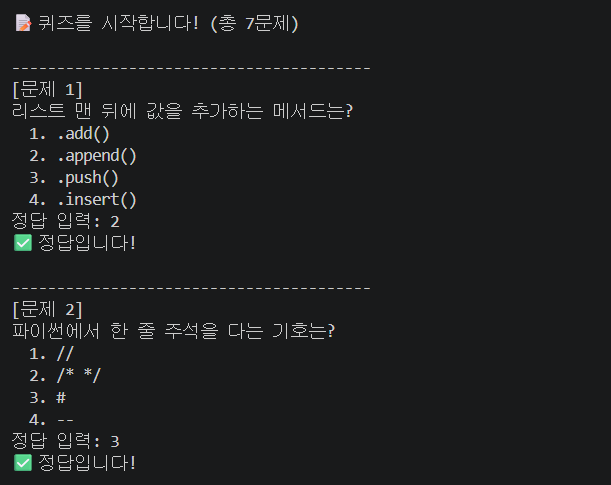
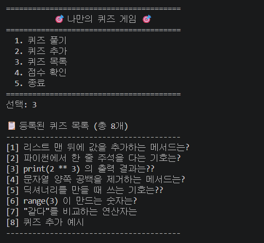
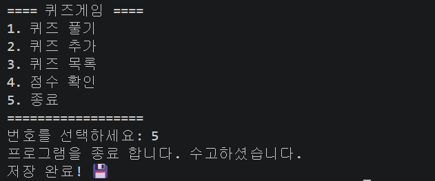

# 🎯 나만의 퀴즈 게임 (E1-2)

터미널에서 동작하는 콘솔 기반 퀴즈 게임입니다. Python 기본 문법과 JSON 파일 저장으로 데이터 영속성을 구현하고, Git으로 변경 이력을 관리한 미션 과제입니다.

---

## 📖 프로젝트 개요

파이썬으로 만든 콘솔 기반 퀴즈 게임입니다. 사용자는 퀴즈를 풀고, 직접 문제를 추가하며, 점수를 기록할 수 있습니다. 프로그램을 종료해도 추가한 퀴즈와 최고 점수가 `state.json` 파일에 저장되어, 다시 실행할 때 이어서 사용할 수 있습니다.

주요 메뉴는 다음 5가지입니다.

1. 퀴즈 풀기
2. 퀴즈 추가
3. 퀴즈 목록
4. 점수 확인
5. 종료

---

## 💡 퀴즈 주제와 선정 이유

**주제: 파이썬 기초 문법**

파이썬을 처음 배우면서 가장 헷갈렸던 개념들을 퀴즈로 만들었습니다. 리스트 메서드, 주석 기호, 연산자, 문자열 메서드, 자료형 등 직접 공부하며 어려웠던 내용을 문제로 정리하면, 저도 복습이 되고 다른 사람도 함께 배울 수 있다고 생각해 선정했습니다. 기본 퀴즈로 5문제 이상을 직접 작성해 포함했습니다.

---

## 🚀 실행 방법

Python 3.10 이상이 필요합니다. 외부 라이브러리 없이 표준 라이브러리만 사용합니다.

```bash
python main.py
```

> 환경에 따라 `python3 main.py` 로 실행합니다.

실행하면 아래 메뉴가 나타납니다.


---

## ✨ 기능 목록

| 번호 | 기능 | 설명 |
|------|------|------|
| 1 | 퀴즈 풀기 | 등록된 문제를 순서대로 출제하고 정답/오답을 확인한 뒤, 총 점수를 표시합니다. |
| 2 | 퀴즈 추가 | 문제, 보기 4개, 정답 번호를 입력받아 새 퀴즈를 등록합니다. |
| 3 | 퀴즈 목록 | 현재 등록된 퀴즈 목록을 확인합니다. |
| 4 | 점수 확인 | 최근 점수와 최고 점수를 확인합니다. |
| 5 | 종료 | 데이터를 저장하고 프로그램을 종료합니다. |

**퀴즈 풀기**



**퀴즈 추가**


**퀴즈 목록**



**점수 확인**


**자동 저장 / 불러오기** — 종료 시 저장되고, 실행 시 불러옵니다.



---

## 📂 파일 구조

```
E1-2/
├── main.py              # 메인 프로그램 (실행 진입점)
├── state.json           # 퀴즈·최고 점수 저장 파일 (프로젝트 루트, UTF-8)
├── README.md            # 프로젝트 설명 문서
├── .gitignore           # Git 추적 제외 설정 (__pycache__ 등)
└── docs/
    └── screenshots/     # 실행 화면 캡처
        ├── menu.png
        ├── play.png
        ├── add_quiz.png
        ├── quiz_list.png
        ├── score.png
        └── save.png
```

---

## 💾 데이터 파일 설명 (state.json)

- **경로**: 프로젝트 루트 (`main.py`와 같은 위치)
- **역할**: 퀴즈 목록과 최고 점수를 저장하고 불러옵니다. 프로그램 종료 시 저장되고, 실행 시 불러옵니다.
- **인코딩**: UTF-8 (한글이 깨지지 않도록 `ensure_ascii=False`로 저장)
- **예외 처리**: 파일이 없으면 기본 퀴즈 데이터로 시작하고, 파일이 손상된 경우에도 `try/except`로 처리해 기본 데이터로 복구합니다.

### 스키마

```json
{
  "quizzes": [
    {
      "question": "리스트 맨 뒤에 값을 추가하는 메서드는?",
      "choices": [".add()", ".append()", ".push()", ".insert()"],
      "answer": 2
    }
  ],
  "best_score": 1
}
```

| 키 | 타입 | 설명 |
|------|------|------|
| `quizzes` | list | 퀴즈 문제들의 목록 |
| `question` | str | 문제 내용 |
| `choices` | list(str) | 보기 4개 |
| `answer` | int | 정답 번호 (1~4) |
| `best_score` | int | 역대 최고 점수 |

---

## 🛠 개발 환경

- Python 3.10 이상
- 외부 라이브러리 없이 표준 라이브러리만 사용 (`json`, `os`)
